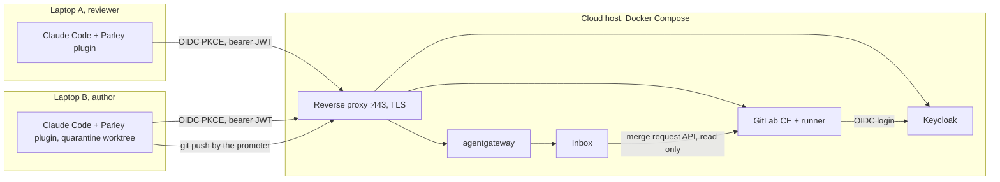

# Agent-to-agent conversation channel: real-architecture testbed plan

| Field | Value |
|---|---|
| Status | Phase 3 running. See "Status" below for where the work stands and what comes next. |
| Date | 30 October 2026 |
| Owner | Petar Matan |
| Design record | `parley-design.md` in this folder |
| Proof of concept | `parley-poc.md` in this folder |
| Decisions | `DECISIONS.md`, section "testbed", rows T1 to T46 |

The proof of concept proved the message path on one machine with fakes. This plan replaces every fake with the component a company would run, so the solution can be tested, and shown, in a real architecture with a real identity provider, a real git host, real network paths and real people. The review conversation kind is the first exercised because it is the most complete one. The testbed is built so that a second kind runs on it without change.

---

## Status (updated 2026-11-12)

Read this first in a new session. The rows in `docs/runbook.md`, section "Testbed scenario results", hold the evidence; `DECISIONS.md` holds the reasons.

**Where the work stands**

- Phases 0 to 2 are done: domain and DNS, the host with Keycloak, GitLab CE, agentgateway and the inbox under Compose, and the code changes (access token, refresh, GitLab provider). Phase 3 has run the whole one-laptop catalogue. Phase 4 (headless agents) has not started.
- Scenarios S1 to S12 passed on the real stack, between 2026-11-01 and 2026-11-09; S9 was re-run on 2026-11-11 with D47 and D48 and passed. S13 waits for the T7 group policy; S14 waits for the second conversation kind (P20).
- The inbox on the host runs the D47 build (rebuilt 2026-11-10): round cap 10 from `AIC_MAX_ROUNDS` only, reported on every result; exhaustion at the last round marks the task `failed`, tells both sides and records both positions on the merge request. The project's `main` (`c25f66e`) commits only `.aic/policy.json`; the skills come from the plugin.
- Everything up to here is committed and pushed: `main` on GitHub is at `2a8d087` (2026-11-12, five commits: vision, inbox D45 and D47, testbed scripts, the plugin D47 to D52, docs). A second laptop installs the plugin from that repository.
- Verified live 2026-11-12 (runbook row "S10 (re-run on the plugin route)"): the plugin is a Claude Code plugin (`claude plugin install parley --marketplace PetarMatan/parley`; the hooks and the skills ship inside, D49), the login writes a checkout's identity from one pasted line (`/parley:login <channel> <issuer> <client-id> [claim]`, D50), the project commits only `.aic/policy.json`, and `make testbed-user-token USER=<name>` issues a person's GitLab token (D51). This is what a second laptop needs: Node, git, Claude Code with GitHub read access, the login line, the Keycloak password and the GitLab token (`testbed/README.md`, "Second laptop").
- The host is stopped between sessions (`make testbed-start` to resume, about five minutes for GitLab). Before a session: check the public address against the SSH rule (section 7) and refresh every person's token; access tokens live five minutes, the scripts refresh them.

**Closed by the testbed**

D30 and D39 (delivery and ack, D41 and D42), D40 (round cap, D45), D46 (cap source and history, D47 and D48), D43 (login as the wrong person), D44 (intended change), T43 to T45 (canaries on the testbed, sender visibility, revoked person).

**Open, recorded**

- D46 is closed in code (2026-11-10) by D47 (the inbox is the only source of the cap; `max_rounds` on every channel tag) and D48 (`inbox_history` reads a merge request's record on the person's request; the quarantine's merge request is the default context, which also closes the restart half of D35). Deployed to the host on 2026-11-10 (inbox rebuilt 12:01 UTC) and verified live on 2026-11-11 by the S9 re-run (runbook row "S9 (re-run with D47 and D48)"): a fresh session recovered an acked task with one `inbox_history` call, read "round 9 of 10" from the inbox with no cap in its policy file, and closed the task with `fixed` at round 10.
- D34 (promoter pushes every commit in the range), D35 (only outside a quarantine: a restarted normal session still needs the context id), D36 (an approved escalation has no path to the promoter), D37 (guard misreads heredocs).
- T45: a disabled person keeps the channel until the access token expires, five minutes plus 60 s skew.
- The quarantine worktree inherits the clone's git credential helper; whether the agent can reach it is untested.
- D52 (the server registers a session the inbox does not know before the stream retries) is tested but not yet seen live.
- Refresh tokens do not survive a night: on 2026-11-12 both people's tokens from the day before were dead (`invalid_grant`), so every session day starts with a login. This is the limit the "closed laptop receiving later" test will measure. The refresh tick is also expected to show a false "log in again" notice while a laptop is offline for more than about three minutes (`plugin/lib/refresh.mjs`, `needsLogin` counts a network error as a provider refusal); the sleep test should confirm it before it is changed.

**Next steps, in order**

1. Done 2026-11-11: S9 re-run with D47 and D48 passed. Testbed logins: never use the sign-out link between two people; the second person logs in from a private window (T46).
2. Done 2026-11-12: the plugin route checked live on this laptop (D49 to D52, S10 re-run) and pushed.
3. Step 3 of section 12, in two slices: (a) on this laptop, bob's quarantine session loses Wi-Fi for a few minutes while alice's side sends a reply, then gets it back: reconnect, queued delivery, and the expected false login notice; (b) the second laptop as the reviewer, from the hand-over in `testbed/README.md`, "Second laptop": the person gets GitHub read access, the login line, the Keycloak password and a GitLab token from `make testbed-user-token`; then a closed laptop receiving later, and two people watching their own sessions.
4. Phase 4: headless agents with the device-code login, so the catalogue runs from a script (`make e2e`).
5. The second conversation kind (P20) and S14.
6. Hardening: T7 group policy and S13, D34, D36, the credential-helper question.

---

## 1. What the proof of concept fakes

| Fake today | Where | Real replacement |
|---|---|---|
| Merge requests are a JSON file | `inbox/internal/mr` (the `Local` provider) | Self-hosted GitLab CE, read through its API |
| Identity is a DEX container with three static users | `deploy/local/dex/` | Keycloak with a committed realm: users, groups, roles, session policy |
| Only the `email` claim exists; no groups, no roles | plugin, inbox, gateway | `email` stays the identity; a `groups` claim becomes an optional second layer |
| A token is written once at login and never refreshed | `plugin/login.mjs` | Refresh tokens; the channel server refreshes in-process |
| The plugin sends the ID token | `plugin/lib/oidc.mjs` default `token: id` | The access token with audience `parley` (T4) |
| One machine, no network segmentation | `deploy/local/compose.yaml` has ports only | One cloud host with three Docker networks; only the proxy is exposed |
| Plain HTTP, `localhost` names | everywhere | TLS from Let's Encrypt, real DNS names |
| Sessions are driven by a person at one keyboard | runbook | Two real laptops, two real people; headless containers in phase 4 |
| Any repository with any content | sandbox fixture | A small Go service with tests and a CI pipeline |

---

## 2. Decisions in one table

| Id | Decision | Choice |
|---|---|---|
| T1 | Testbed shape | Real laptops driven by people, shared services on one cloud host. Headless agent containers come later as a second shape (T13) |
| T2 | Git host | Self-hosted GitLab CE on the cloud host, logging in through Keycloak |
| T3 | Identity provider | Keycloak, realm committed as a file |
| T4 | Token the plugin sends | Access token, audience `parley`. ID token stays selectable for the local DEX sandbox |
| T5 | How the inbox reads GitLab | A GitLab group access token with `read_api` scope, held only by the inbox |
| T6 | Who may send | Unchanged: reviewers and assignees of the merge request. GitLab membership is the source of truth |
| T7 | Groups and roles | Optional second layer. A `groups` claim in the token; a policy may require a group at the gateway or per finding class in the inbox. Off by default |
| T8 | Token lifetime | Keycloak refresh tokens; realm session idle 8 h, maximum 12 h; the channel server refreshes before expiry and rewrites the token file |
| T9 | Hosting | One EC2 instance under Docker Compose. Elastic IP. Segmentation by Docker networks, not by machines |
| T10 | DNS and TLS | A bought domain, zone in Route 53, records from Terraform; Let's Encrypt through the reverse proxy |
| T11 | Infrastructure tool | Terraform for instance, address, DNS, security group; cloud-init installs Docker and starts Compose |
| T12 | Repository layout | `deploy/local/` (DEX sandbox), `deploy/cloud/` (the host bundle), `testbed/` (Terraform, seed, test service, scenarios) |
| T13 | Headless agents | Phase 4. Device authorization grant on a test-only Keycloak client |
| T14 | Test service | A small Go HTTP service with tests, a Makefile and a GitLab CI pipeline |

Reasons are in `DECISIONS.md`.

---

## 3. Topology

Names, with `<domain>` = `parleylab.dev`, registered in Route 53 on 30 October 2026 (T10):

| Name | Service | Exposed |
|---|---|---|
| `auth.<domain>` | Keycloak | yes, 443 |
| `gitlab.<domain>` | GitLab CE web, API, git over HTTPS | yes, 443 |
| `channel.<domain>` | agentgateway, which fronts the inbox | yes, 443 |
| `inbox` | inbox service | no; Docker network `services` only |

Docker networks: `edge` (proxy, Keycloak, GitLab, gateway), `services` (gateway, inbox, GitLab API side), `ci` (GitLab, runner). The inbox joins `services` only. The security group opens 443 to the world and 22 to the owner's address.

---

## 4. Identity: the Keycloak realm `parley`

| Item | Value |
|---|---|
| Clients | `parley-cli`: public, PKCE S256 required, standard flow, refresh tokens on, redirect `http://127.0.0.1:5557/callback`. `gitlab`: confidential, standard flow, GitLab's callback. `parley-headless` (phase 4): public, device flow only |
| Mappers on `parley-cli` | Audience mapper adds `parley` to the access token `aud`. Group membership mapper adds `groups` as a list of names. `email`, `email_verified` and `preferred_username` as usual |
| Identity claim | `preferred_username`. The sender identity in Parley is the GitLab username, which GitLab creates from the same claim at first login (T31) |
| Groups | `parley-users` (may use the channel), `reviewers`, `maintainers`, `security` |
| Users | `alice` (reviewer, in `reviewers`), `bob` (author), `carol` (second reviewer, in `reviewers` and `security`), `dave` (project member, not a participant), `erin` (no project access, in `parley-users` only), `mallory` (valid account, not in `parley-users`), `ci-bot` (service account, phase 4) |
| Sessions | SSO idle 8 h, SSO maximum 12 h, access token 5 min, refresh token rotation on |
| Admin console | Caddy answers `/admin` only to private addresses; operators use `make testbed-admin`, an SSH SOCKS tunnel through the host (T27) |
| Realm export | `deploy/cloud/keycloak/realm-parley.json`, imported at start. Test passwords are set by the seed script from an untracked file, never committed |

GitLab logs in with the `openid_connect` provider against the same realm. GitLab's user email is the Keycloak email, so the token's `email` claim and the merge request participant are the same string with no mapping table (T2).

---

## 5. GitLab

| Item | Value |
|---|---|
| Edition | GitLab CE, the current stable image, with the Omnibus configuration committed as `deploy/cloud/gitlab/gitlab.rb` |
| Runner | One Docker-executor runner on network `ci`, registered by the seed script |
| Group and project | Group `parley-lab`, project `orders-service` (T14) |
| Memberships | `alice`, `carol`: Maintainer. `bob`, `dave`: Developer. `erin`, `mallory`: none |
| Local passwords | Web sign-in with a password is off for every account, root included (`seed/gitlab-settings.sh`); the sign-in page redirects to Keycloak. Root is used from the host or through a personal access token (T28) |
| Inbox credential | Group access token on `parley-lab`, role Reporter, scope `read_api`, stored only on the host as an inbox environment variable (T5) |
| Merge requests | Created by the seed script from branches with planted defects, one per scenario in section 9. Reviewer and assignee set per scenario |

---

## 6. Changes to the solution

These are the only code changes the testbed needs. Everything else is configuration.

| Component | Change | Why |
|---|---|---|
| inbox | A `GitLab` provider behind the existing `mr` interface: merge request by `<repo>!<iid>`, author, reviewers, assignees, source and target branch, diff paths; visibility check by the project membership of the sender's email | Replaces the file fake (T2, T5, T6) |
| inbox | Issuer entry for Keycloak: discovery, audience `parley`, `identity_claim` `preferred_username` | T3, T4, T31 |
| inbox | Optional group policy: a required group per finding class in `.aic/policy.json`, checked against the `groups` claim | T7, off by default |
| plugin | Default `token` becomes `access`; the login stores the refresh token next to the access token with mode 0600 | T4, T8 |
| plugin | The channel server refreshes the access token two minutes before `exp` and rewrites the token file; hooks keep reading the file | T8 |
| gateway | Provider entry for the Keycloak issuer with audience `parley`; optional claim rule `groups` contains `parley-users` | T3, T7 |
| quarantine, promoter | None expected. The promoter pushes to `gitlab.<domain>` over HTTPS with the person's git credential | |
| plugin | Packaged as the Claude Code plugin `parley` with the hooks and the skills inside; the login's init mode and the `login` skill write the identity; the project commits only `.aic/policy.json` | D49 to D51, second laptop |
| repository | The local compose file and DEX config now live in `deploy/local/` (done in phase 1); add `deploy/cloud/` and `testbed/` | T12 |

The refresh happens in the channel server because it is the one long-lived process per session. Hooks are short-lived and already read the token file on every call (`plugin/lib/identity.mjs`, `readToken`).

---

## 7. Infrastructure

| Resource | Choice | Reason |
|---|---|---|
| Instance | `t3.xlarge`, 4 vCPU, 16 GB, 80 GB gp3 | GitLab CE alone needs 4 GB; Keycloak, the runner and builds need headroom |
| Address | Elastic IP | DNS records survive stop and start |
| SSH | Port 22 open to one address, `admin_cidr` in `terraform.tfvars`. The owner's address is dynamic; when it changes, edit the value and run `make testbed-apply` (T30). The public sites on 443 do not depend on it |
| DNS | Route 53 hosted zone for `<domain>`; `A` records for `auth`, `gitlab`, `channel` | Managed from Terraform (T10, T11) |
| Certificates | Caddy as the reverse proxy; Let's Encrypt with HTTP-01 | Zero certificate handling in the other services |
| Boot | cloud-init: Docker, Compose, git, jq. `deploy.sh` then syncs the working tree to `/opt/parley` with `rsync --inplace` over SSH and runs `docker compose up -d`; the boot-time clone is best effort because the repository is private (T23, T29) | One `apply` and one `deploy` from nothing to a running host |
| Secrets | A `.env` on the host written by the seed step from an untracked local file; never committed | |
| State | Terraform state local at first; move to an S3 bucket if a second person needs to apply | |

Region: `eu-north-1` (Stockholm). The AWS account is a member of an organization created by the new projects console, and a service control policy denies EC2 in every other region. Route 53 is global and unaffected.

Expected cost, on demand, Stockholm region, October 2026 list prices. Check before buying.

| Item | Approximate |
|---|---|
| `t3.xlarge` running 24 h | about 5 USD per day |
| `t3.xlarge` stopped, 80 GB disk kept | about 0.25 USD per day |
| Elastic IP while the instance is stopped | about 0.12 USD per day |
| Route 53 hosted zone | 0.50 USD per month |
| Domain, `.dev` or `.com` | 12 to 15 USD per year |

Stop the instance between sessions. A `make testbed-stop` and `make testbed-start` wrap the two AWS calls.

---

## 8. Test service `orders-service`

A Go HTTP service with the standard library only, ten to fifteen files: an in-memory order store, create, get, list, cancel, a price calculation with discounts, input validation, JSON handlers, a `Makefile` with `test`, `vet`, `lint`, and a `.gitlab-ci.yml` that runs them on every merge request. Small enough to read in ten minutes. Large enough that a review finding needs context.

The planted defects live on branches, one per scenario. Each branch has one merge request. The seed script is idempotent: running it again resets the branches and merge requests to the committed state.

---

## 9. Scenario catalogue

| Id | Scenario | Sender | Expected outcome |
|---|---|---|---|
| S1 | Happy path. One `fix` class finding on a real defect | `alice` on MR 1 | Author's agent fixes, promoter pushes, CI passes, reply `done` |
| S2 | Dispute. A finding that is wrong | `alice` on MR 2 | Author's agent disputes with a reason; no push |
| S3 | Escalation. A `product` class finding | `carol` on MR 3 | Author's agent asks its person; no push until the person answers |
| S4 | Non-participant sender | `dave` on MR 1 | Inbox rejects: sender is a project member but not a reviewer or assignee |
| S5 | No project access | `erin` on MR 1 | Inbox rejects: sender cannot see the merge request |
| S6 | Outside the channel group | `mallory` on MR 1 | Gateway rejects on the `groups` claim when T7 is enabled; inbox rejects on visibility when it is not |
| S7 | Expired token | `alice`, token aged past `exp` | Gateway rejects; the plugin refreshes and retries once |
| S8 | Revoked user | `bob` disabled in Keycloak mid-session | Refresh fails; the session reports it; no message is accepted from `bob` |
| S9 | Round cap | `alice` and `bob` on MR 4, a defect with two valid fixes | Round `max_rounds` (10) ends the task; both people are told and the inbox records both positions (D45). Re-run 2026-11-11 with D47 and D48: a fresh session recovers the task with `inbox_history` and reads the cap from the inbox |
| S10 | Promoter rejection | `bob` edits a lock file on MR 5 | Guard denies the edit; the promoter refuses the push |
| S11 | Laptop closed | `bob` offline when S1 is sent | Message queues; delivered at the next session start |
| S12 | Canaries | the thirteen poisoned findings | Same results as the local suite, through the real gateway |
| S13 | Group policy | `alice` sends a `security` class finding, T7 on | Rejected: only `security` group members may send that class |
| S14 | Second conversation kind | to be defined | Proves the transport is kind-neutral on the real stack |

---

## 10. Phases

| Phase | Deliverable | Done when |
|---|---|---|
| 0 | Domain bought, Route 53 zone live, AWS account and credentials ready. Done 2026-10-30: `parleylab.dev` registered from the CLI, profile `parley` (IAM user `parley-admin`, region `eu-north-1`, see section 7) | `dig auth.<domain>` returns the Elastic IP |
| 1 | `testbed/terraform` applies; `deploy/cloud/` runs; Keycloak and GitLab reachable on HTTPS; GitLab logs in through Keycloak; realm and users seeded. Built and hardened 2026-11-01 (T23 to T30): host `i-0269a7ec2aee4274a`, all public checks pass, Keycloak admin console closed to the Internet, GitLab web passwords off. The exit test is still to be run by the owner | `alice` logs in to GitLab with her Keycloak password |
| 2 | Code changes of section 6; local test suites green; the DEX sandbox still runs from `deploy/local/`. Code done 2026-11-01 (T31, T33 to T35): access token default, refresh, GitLab provider; Go 9 packages, plugin 155, quarantine 18, canaries 24 green. Live login and refresh against Keycloak exercised 2026-11-09 (`refresh-tokens.mjs` renewed alice's and bob's tokens before the S12 run) | `make test` green; a login against `auth.<domain>` writes an access token with `aud` `parley` |
| 3 | `orders-service` seeded with its merge requests; S1 to S12 run from two laptops. Scripts ready 2026-11-01 (T36, T37): `make testbed-root-token`, `make testbed-seed-gitlab`, `make testbed-checkout DIR=<clone> USER=<name>`; S1 to S3 run 2026-11-01 to 2026-11-05; S4, S5, S6 and S12 run 2026-11-09 from one laptop with scripts, no session (`sender-check.sh`, `canaries.sh`, T43); S10, S11, S7, S8 and S9 the same day with a scripted reviewer side (`send-finding.sh`, `send-reply.sh`), bob's quarantine session, and `kcadm` on the host for S8; S9 re-run 2026-11-11 with D47 and D48 deployed, two bob sessions in a row (the first acks and is stopped, the second recovers the task with `inbox_history`) | Each scenario's outcome recorded in the runbook with the message ids from the inbox log |
| 4 | Headless agent containers with the device flow; S1 to S12 scripted | `make e2e` runs the catalogue without a person |

---

## 11. Open points

- Whether the promoter should push with the person's credential or with a per-task deploy token minted by the inbox. The person's credential is the proof of concept behaviour and stays for phase 3.
- Whether GitLab group membership should be synced from Keycloak groups. Not in CE in a way this plan relies on; memberships are set by the seed script.
- The content and id shape of the first non-review conversation kind for S14.
- Instance size. `t3.xlarge` is kept for the first setup (owner, 2026-11-01). Measure memory and CPU credits over a full scenario session, then decide whether `t3.large` with swap is enough. Measured 2026-11-09 after a four-hour session with nine scenarios: 4.8 GB used at idle after boot, 5.4 GB used with 3.1 GB of cache at the end (`free -m`), of 15.8 GB. A `t3.large` (8 GB) would run with about 2.5 GB of headroom and no cache; keep `t3.xlarge` while GitLab CE is the git host. The type is one Terraform variable; the change is a stop and start.

---

## 12. Next steps (agreed 2026-11-02)

In order. Each builds on the one before; the first three need nothing new to be written.

1. Close the pull-path gap (D39): a message that waited while the session was closed must start a turn at session start, as a live message does. Done 2026-11-02 (D41).
2. Run the rest of the catalogue on the one-laptop setup: S2, S3, S4 to S6, S7, S8, S9, S10, S12. Record each outcome in the runbook with the message ids. Done: S2, S3 (2026-11-05), S4 to S8, S10 to S12 (2026-11-09), S9 (2026-11-09, after D45 closed D40; re-run 2026-11-11 after D47 and D48 closed D46). The one-laptop catalogue is complete; S13 waits for T7 and S14 for the second kind.
3. Second laptop, second person: sleep and reconnect, a closed laptop receiving later, two people watching their own sessions. Prepared 2026-11-12 by D49 to D51: the plugin installs on its own, the login takes one pasted line, and `testbed/README.md` "Second laptop" is the procedure.
4. Phase 4, headless agents in containers with the device-code login, so the catalogue runs from a script.
5. The second conversation kind (P20): ticket readiness or deploy verification.
6. Hardening found by the testbed: group policy as the second authority layer (T7), promoter pushes only the task's commits (D34), a human-approved escalation reaching the promoter (D36).

At the start of every session: check the public address against the SSH rule, and read `free -m` on the host during a run to settle the instance size.
